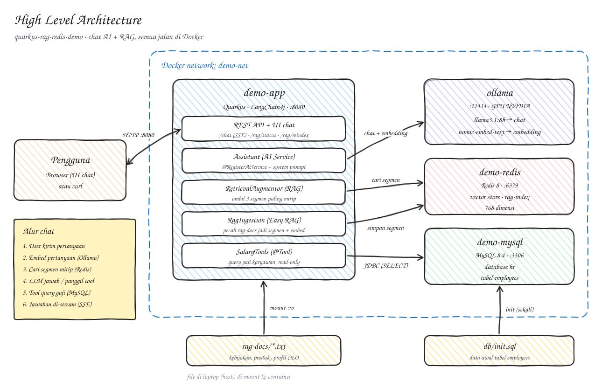

# demo

Aplikasi Quarkus (JVM mode) dengan chat AI berbasis Ollama, RAG (embedding disimpan di Redis), dan database MySQL.
Dokumen ini menjelaskan cara menjalankan semuanya di Docker.

- Source code: [github.com/erfinfeluzy/quarkus-rag-redis-demo](https://github.com/erfinfeluzy/quarkus-rag-redis-demo)
- Image aplikasi: [quay.io/efeluzy/quarkus-rag-redis](https://quay.io/repository/efeluzy/quarkus-rag-redis)

Clone source code:

```powershell
git clone https://github.com/erfinfeluzy/quarkus-rag-redis-demo.git
cd quarkus-rag-redis-demo
```

## Arsitektur

<p align="center"></p>

Semua container berada di satu network Docker buatan sendiri, `demo-net`. Di network seperti ini Docker
menyediakan DNS internal, jadi container saling memanggil pakai nama container-nya.

| Service  | Container    | Alamat dari dalam network         | Port di laptop    |
| -------- | ------------ | --------------------------------- | ----------------- |
| MySQL    | `demo-mysql` | `jdbc:mysql://demo-mysql:3306/hr` | `3306`            |
| Redis    | `demo-redis` | `redis://demo-redis:6379`         | `6379`            |
| Ollama   | `ollama`     | `http://ollama:11434`             | `11434`           |
| Aplikasi | `demo-app`   | `http://demo-app:8080`            | `8080`            |

Port ke laptop (`-p ...`) hanya dibutuhkan supaya service bisa diakses dari laptop (browser, DBeaver,
redis-cli). Antar container tidak butuh `-p`.

## Requirement

- Docker Desktop, bisa juga diganti Podman
- JDK 25 (untuk build jar dengan `mvnw`)
- GPU NVIDIA + driver terbaru untuk Ollama (`--gpus all`). Tanpa GPU, hapus opsi `--gpus all`; Ollama tetap jalan tapi lebih lambat. Penulis menggunakan 8 GB VRAM untuk menjalankan LLM pada Ollama
- HDD sekitar 6 GB untuk model `llama3.1:8b` dan `nomic-embed-text`

## Let's hands on

Perintah di bawah ditulis untuk PowerShell (backtick `` ` `` untuk lanjut baris) dan dijalankan dari folder project.

### 1. Buat network (sekali saja)

```powershell
docker network create demo-net
```

### 2. MySQL

`db/init.sql` dijalankan otomatis saat volume data masih kosong (pertama kali container dibuat).

```powershell
docker run -d --name demo-mysql --network demo-net `
  -p 3306:3306 `
  -e MYSQL_ROOT_PASSWORD=rootpass `
  -e MYSQL_DATABASE=hr `
  -e MYSQL_USER=hr_app `
  -e MYSQL_PASSWORD=hr_app_pass `
  -v "${PWD}/db/init.sql:/docker-entrypoint-initdb.d/init.sql:ro" `
  -v demo_mysql-data:/var/lib/mysql `
  mysql:8.4
```

Tunggu sampai MySQL siap sebelum menjalankan aplikasi:

```powershell
docker exec demo-mysql mysqladmin ping -h 127.0.0.1 -uhr_app -phr_app_pass
```

### 3. Redis (embedding store RAG)

```powershell
docker run -d --name demo-redis --network demo-net `
  -p 6379:6379 `
  -v demo_redis-data:/data `
  redis:8
```

### 4. Ollama

Kalau container `ollama` sudah ada (misalnya dipakai project lain), cukup sambungkan ke `demo-net`:

```powershell
docker network connect demo-net ollama
```

Kalau belum ada, buat baru:

```powershell
docker run -d --name ollama --network demo-net --gpus all `
  -p 11434:11434 `
  -e OLLAMA_HOST=0.0.0.0:11434 `
  -e OLLAMA_CONTEXT_LENGTH=32768 `
  -v ollama:/root/.ollama `
  ollama/ollama
```

Download model (sekali saja, tersimpan di volume `ollama`):

```powershell
docker exec ollama ollama pull llama3.1:8b
docker exec ollama ollama pull nomic-embed-text
```

### 5. Ambil image aplikasi dari Quay

Image aplikasi sudah tersedia di [quay.io/efeluzy/quarkus-rag-redis](https://quay.io/repository/efeluzy/quarkus-rag-redis),
jadi tidak perlu build sendiri:

```powershell
docker pull quay.io/efeluzy/quarkus-rag-redis:latest
```

Ingin build image sendiri dari source code? Lihat [Build dan push image](#build-dan-push-image).

### 6. Jalankan aplikasi

Konfigurasi di `application.properties` sudah memakai nama container (`ollama`, `demo-mysql`, `demo-redis`).
Environment variable `-e QUARKUS_...` di bawah opsional; pakai untuk menimpa alamat kalau nama container berbeda.
Folder `rag-docs` di-mount supaya dokumen RAG bisa diubah tanpa build ulang image.

```powershell
docker run -d --name demo-app --network demo-net `
  -p 8080:8080 `
  -v "${PWD}/rag-docs:/deployments/rag-docs:ro" `
  -e QUARKUS_DATASOURCE_JDBC_URL=jdbc:mysql://demo-mysql:3306/hr `
  -e QUARKUS_REDIS_HOSTS=redis://demo-redis:6379 `
  -e QUARKUS_LANGCHAIN4J_OLLAMA_BASE_URL=http://ollama:11434 `
  -e QUARKUS_LANGCHAIN4J_EASY_RAG_PATH=/deployments/rag-docs `
  quay.io/efeluzy/quarkus-rag-redis:latest
```

Lihat log:

```powershell
docker logs -f demo-app
```

Opsi tambahan untuk `demo-app`:

- Remote debug: `-p 5005:5005 -e JAVA_DEBUG=true -e JAVA_DEBUG_PORT=*:5005`
- Batas memori: `-m 1g`

## Mencoba aplikasi

Aplikasi berjalan di <http://localhost:8080>.

```powershell
# Endpoint sederhana
curl.exe http://localhost:8080/hello

# Chat (respons berupa stream Server-Sent Events)
curl.exe -N -X POST http://localhost:8080/chat -H "Content-Type: text/plain" -d "Apa saja kebijakan cuti kantor?"

# Jumlah segmen dokumen RAG di Redis
curl.exe http://localhost:8080/rag/status

# Baca ulang dokumen di rag-docs setelah ada perubahan
curl.exe -X POST http://localhost:8080/rag/reindex
```

Dokumen di `rag-docs` hanya di-ingest otomatis saat aplikasi start dan Redis masih kosong. Setelah mengubah atau
menambah file `.txt` di folder itu, panggil `POST /rag/reindex`.

## Cek network

Container yang ada di `demo-net`:

```powershell
docker network inspect demo-net --format "{{range .Containers}}{{.Name}} {{end}}"
```

Tes DNS dari dalam container aplikasi:

```powershell
docker exec demo-app curl -s http://ollama:11434/api/tags
```

## Stop, hapus, dan deploy ulang

Stop semua:

```powershell
docker stop demo-app demo-mysql demo-redis
```

Start lagi container yang sudah ada:

```powershell
docker start demo-mysql demo-redis ollama demo-app
```

Update ke image terbaru di Quay:

```powershell
docker rm -f demo-app
docker pull quay.io/efeluzy/quarkus-rag-redis:latest
# lalu jalankan lagi perintah di langkah 6
```

## Build dan push image

Setelah ada perubahan kode, build jar dan image, lalu push ke Quay (perlu `docker login quay.io` dengan akun
yang punya akses tulis):

```powershell
.\mvnw.cmd package -DskipTests
docker build -f src/main/docker/Dockerfile.jvm -t quay.io/efeluzy/quarkus-rag-redis:latest .
docker push quay.io/efeluzy/quarkus-rag-redis:latest
```

Setelah itu ganti container aplikasi seperti di bagian sebelumnya.

## Troubleshooting

- **`name is already in use`**: container dengan nama itu sudah ada. Start dengan `docker start <nama>`, atau hapus
  dulu dengan `docker rm -f <nama>`. Data MySQL dan Redis tetap aman karena disimpan di volume
  (`demo_mysql-data`, `demo_redis-data`).
- **Aplikasi gagal konek ke MySQL saat start**: MySQL belum selesai inisialisasi. Tunggu sampai `mysqladmin ping`
  berhasil, lalu `docker restart demo-app`.
- **`init.sql` tidak dijalankan**: skrip init hanya berjalan saat volume masih kosong. Untuk mengulang dari awal
  (semua data hilang): `docker rm -f demo-mysql` lalu `docker volume rm demo_mysql-data`, kemudian ulangi langkah 2.
- **Chat lambat atau timeout**: pastikan model sudah di-pull dan Ollama memakai GPU (`docker exec ollama nvidia-smi`).
  Timeout bawaan 120 detik (`quarkus.langchain4j.ollama.timeout`).

## Menjalankan tanpa Docker (dev mode)

MySQL, Redis, dan Ollama tetap dijalankan di Docker (langkah 1 sampai 4), lalu aplikasinya dijalankan langsung di
laptop dengan live coding:

```powershell
.\mvnw.cmd quarkus:dev
```

Dev UI tersedia di <http://localhost:8080/q/dev/>.
